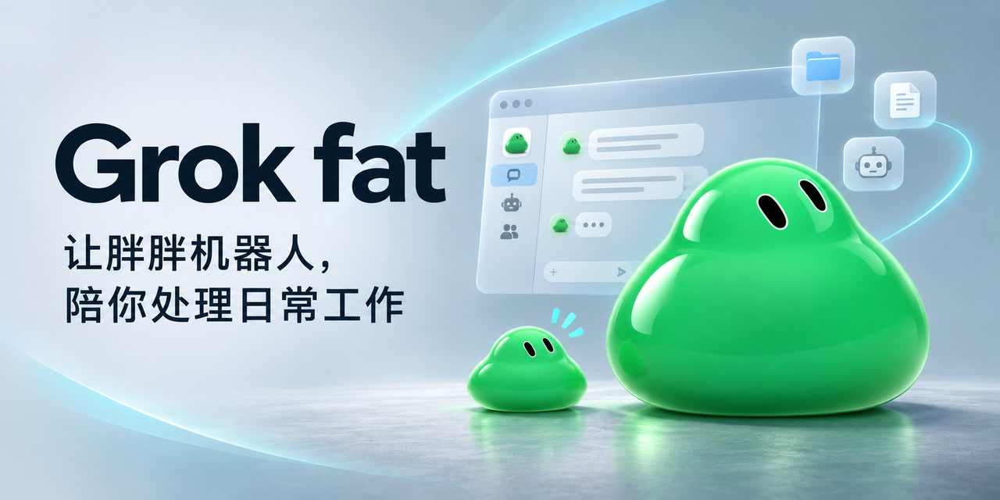
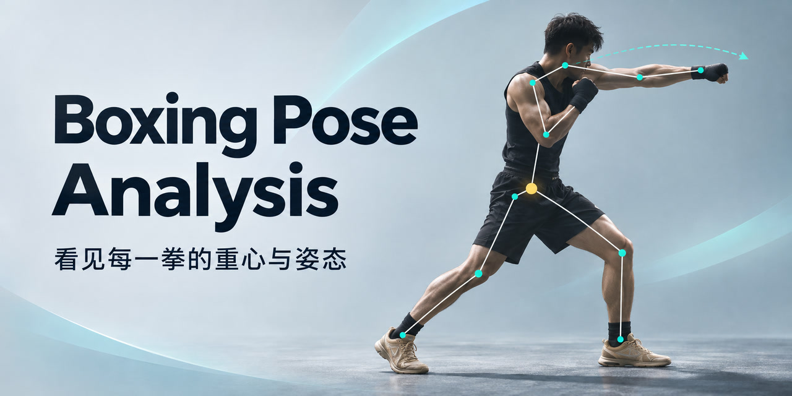
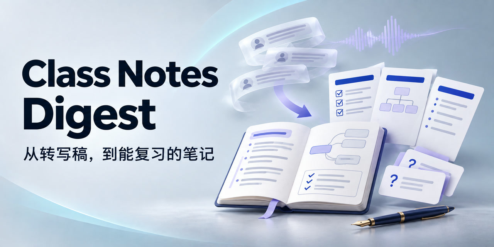
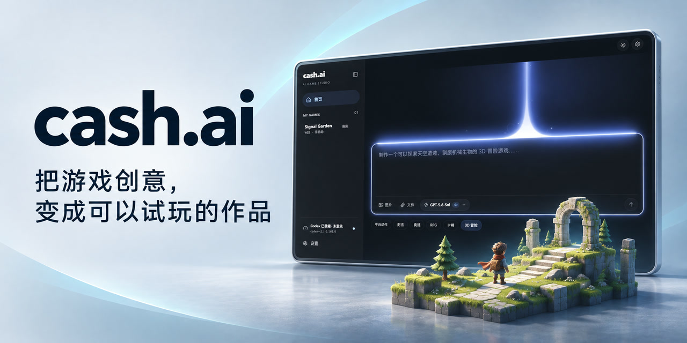

<a href="https://z2302743489.github.io/">个人网站</a> &nbsp;·&nbsp; <a href="#项目作品">项目作品</a> &nbsp;·&nbsp; <a href="https://github.com/z2302743489?tab=repositories">全部仓库</a>

## 项目作品

从模型选型、桌面 Agent 到运动反馈与学习整理，记录围绕具体场景的产品实践。

<table>
<tr>
<td width="50%" valign="top">

<strong><a href="https://github.com/z2302743489/ai-model-atlas">模型全景 · AI Model Atlas</a></strong> 
一个汇总国内外主流大模型的网站，集中查看各模型的介绍、功能特点、能力排名、价格和使用额度。 
国内外大模型导航网站

</td>
<td width="50%" valign="top">

<strong><a href="https://github.com/z2302743489/Grok-fat">Grok fat · 个人 Agent 桌面版</a></strong> 
多机器人协作、工具调用与本地办公，加入 Fat 动态头像。 
桌面 Agent · 基于 OpenMausBot 定制

</td>
</tr>
<tr>
<td width="50%" valign="top">

<strong><a href="https://github.com/z2302743489/boxing-pose-analysis">拳击动作与重心分析</a></strong> 
用手机训练视频，观察姿态、重心转移与逐拳反馈。 
Python · 2D 姿态分析

</td>
<td width="50%" valign="top">

<strong><a href="https://github.com/z2302743489/class-notes-digest">课堂纪要拆解</a></strong> 
把转写稿与课堂群聊，整理成纪要、复习清单与自测题。 
Agent Skill · 结构化学习笔记

</td>
</tr>
<tr>
<td width="50%" valign="top">

<strong><a href="https://github.com/z2302743489/cash.ai">cash.ai 游戏创作</a></strong> 
从玩法需求到规划、制作、审查和自动试玩。 
Codex + Godot · 桌面创作工具

</td>
<td width="50%" valign="top">

<strong><a href="https://z2302743489.github.io/">我的个人网站</a></strong> 
个人介绍、AI 产品探索方向与持续记录的产品思考。 
Portfolio · 产品与体验

</td>
</tr>
</table>

工具与技术

![Codex](https://img.shields.io/badge/Codex-000000?style=flat-square&logo=)

